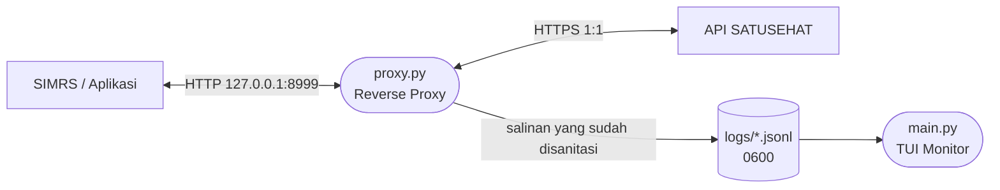

# SATUSEHAT FHIR Monitor

Alat monitoring terminal (**TUI**) + **reverse proxy sidecar** untuk memantau transaksi API SATUSEHAT
(FHIR R4, Consent, KFA) secara **real-time** saat development: lihat payload yang dikirim, response,
status HTTP, latency, dan `OperationOutcome` + *Rule Number* tanpa mengubah kode SIMRS dan tanpa
mengecek tabel database satu per satu.

*English summary: a zero-dependency Python reverse proxy + curses TUI that records and displays SATUSEHAT
(Indonesia's national health data platform) FHIR traffic for developers, with secret redaction, optional PII
masking, private log files, and request-size limits.*

> **Disclaimer.** Proyek ini independen dan **tidak berafiliasi dengan, dibuat, atau didukung oleh Kementerian
> Kesehatan RI / SATUSEHAT**. "SATUSEHAT" hanya menyebut platform yang menjadi target integrasi. Perangkat
> lunak disediakan *apa adanya* (lihat [LICENSE](LICENSE)). Anda bertanggung jawab atas kepatuhan
> penggunaan terhadap UU PDP No. 27/2022, PMK 24/2022 (Rekam Medis Elektronik), dan kebijakan institusi Anda.



## Prasyarat

- **Python 3.10+** - 100% standard library, **tidak perlu `pip install`**.
- Linux / macOS (TUI memakai `curses`; disarankan Linux + `systemd` untuk server).

## Keamanan secara default

| Perilaku | Default |
| :--- | :--- |
| Alamat bind proxy | `127.0.0.1` saja. Alamat lain **ditolak** kecuali `--allow-remote` |
| Header `Authorization`, `client_secret`, token, password | **Tidak pernah** ditulis ke log (selalu disensor) |
| Data pribadi pasien di log | `--mask-pii auto`: **dimasker** bila upstream production, apa adanya bila staging |
| Permission log | File `0600`, folder `0700` (tidak mengikuti symlink) |
| Retensi & ukuran | 14 hari; batas 512 MB/hari; payload > 2 MB hanya disimpan ringkasannya |
| Batas request/response | 20 MB, 64 koneksi paralel, timeout klien lambat 60 dtk |
| Verifikasi TLS ke upstream | Selalu aktif; `--insecure` **ditolak** untuk host production |
| Trafik yang diteruskan | **Tidak diubah** - masking/sanitasi hanya pada salinan log |

Detail model ancaman: [SECURITY.md](SECURITY.md).

## Langkah Penggunaan

### 1. Jalankan proxy
Staging (default):
```bash
python3 src/proxy.py
```
Production:
```bash
python3 src/proxy.py --upstream https://api-satusehat.dto.kemkes.go.id --port 8999
```
Cek proxy aktif: `curl http://127.0.0.1:8999/_health`

**Server (`systemd`):** gunakan [deploy/satusehat-proxy.service](deploy/satusehat-proxy.service). Buat user
khusus dulu (`useradd --system --no-create-home --shell /usr/sbin/nologin satusehat-monitor`), salin proyek ke
`/opt/satusehat-monitor`, lalu `systemctl enable --now satusehat-proxy`. Log tersimpan di
`/var/lib/satusehat-monitor/logs`.

### 2. Arahkan URL aplikasi / SIMRS ke proxy
```dotenv
SATUSEHAT_BASE_URL=http://127.0.0.1:8999/fhir-r4/v1/
SATUSEHAT_CONSENT_URL=http://127.0.0.1:8999/consent/v1/
SATUSEHAT_KFA_URL=http://127.0.0.1:8999/kfa-v2/
# SATUSEHAT_AUTH_URL boleh tetap langsung ke Kemkes (atau lewat proxy; secret disensor otomatis)
```
*Rollback instan:* kembalikan 3 URL di atas ke `https://api-satusehat...`. Proxy dan SIMRS harus berada di
**mesin yang sama** (hop SIMRS -> proxy adalah HTTP polos). Untuk lintas mesin gunakan tunnel terenkripsi (SSH/WireGuard).

### 3. Buka layar monitoring
```bash
./satusehat-tui                       # mode Split: tabel + Request/Response JSON
./satusehat-tui --only-failed         # hanya yang GAGAL / TERTOLAK
./satusehat-tui --log-dir /var/lib/satusehat-monitor/logs --days 3
./satusehat-tui --clear-logs          # hapus semua log (minta konfirmasi; --yes untuk skrip)
```

## Data pasien & privasi - baca sebelum dipakai di production

- **Log berisi data kesehatan** kecuali masking aktif. Perlakukan folder log sebagai data pribadi spesifik:
  enkripsi disk, batasi akses, jangan di-commit, jangan dibagikan di issue/chat.
- Untuk **production**, biarkan `--mask-pii auto` (atau `on`). Yang dimasker: NIK/KK/paspor/MRN
  (`3374********01`), nama pasien & praktisi (`A*** G***`), alamat jalan, telepon, e-mail, tanggal lahir
  (`1990-**-**`), dan parameter query seperti `?name=`/`?identifier=...nik|...`. Yang **tetap terlihat**: struktur
  payload, IHS number (`patient_id`), ID resource/encounter, kode, status, dan *Rule Number* - agar debugging tetap berguna.
- Masking berbasis aturan: **teks bebas** (catatan klinis, `valueString`) hanya disaring pola NIK/telepon/e-mail dan
  **tidak dijamin bersih**. Jangan menganggap log ber-masking aman untuk dibagikan keluar organisasi.
- Staging: `auto` mematikan masking agar nama/ID dummy terbaca penuh. Jika data staging Anda berisi data asli,
  paksa `--mask-pii on`.
- Banyak admin membaca log lewat SSH? Jalankan TUI sebagai user yang sama, **atau** beri grup akses baca dengan
  `SATUSEHAT_LOG_FILE_MODE=640` dan tambahkan admin ke grup tersebut.
- Tombol copy (`c`/`R`/`P`/`u`) menyalin ke clipboard; bila tidak ada clipboard, tersimpan sementara di
  direktori privat per-user dan **dihapus saat TUI ditutup**. Isi yang disalin = isi log (sudah dimasker bila aktif).

## Fungsi utama

- **Real-time:** request payload, response body (`OperationOutcome`), status HTTP (`200`, `201`, `400`, `401`, `422`,
  `429`, `5xx`, `502/504` dari proxy), dan latency diambil dari transaksi HTTP asli, bukan dari log aplikasi.
- **Deteksi error otomatis:** *Rule Number* Kemkes, field yang ditolak (`expression` + `diagnostics`), Patient ID,
  Encounter ID, nomor registrasi.
- **4 mode tampilan:** `[1] Split`, `[2] Table`, `[3] Inspect` (tab Split/Request/Response/cURL), `[4] Summary`.
- **Filter & cari:** hanya error (`e`), per resource (`f`), per status (`s`), cari teks (`/`).
- **Copy & replay:** salin JSON atau perintah cURL yang aman di-*paste* ke shell (semua nilai di-quote). Token diganti
  `<ACCESS_TOKEN>`.
- **Multi-admin:** viewer hanya membaca log; satu-satunya operasi tulis adalah penghapusan log yang eksplisit
  (`D` / `--clear-logs`, dengan konfirmasi).

## Shortcut keyboard

| Tombol | Fungsi |
| :--- | :--- |
| `j` / `k` atau `↓` / `↑` | Pindah baris transaksi (atau scroll JSON saat panel JSON aktif) |
| `Tab` | Pindah fokus `Table` -> `Request JSON` -> `Response JSON` |
| `e` | Toggle filter **Error / Gagal saja** |
| `f` / `s` | Filter per `Resource` (`f`) atau `Status` (`s`) |
| `/` / `x` | Cari teks (`/`), reset semua filter (`x`) |
| `Enter` / `1`-`4` | Buka Mode Inspect (`Enter`) atau pilih Mode `1`-`4` |
| `h` / `l` atau `←` / `→` | Pindah sub-tab di Mode Inspect |
| `J` / `K` atau `PgDn` / `PgUp` | Scroll JSON lebih cepat |
| `c` | Copy sesuai panel aktif |
| `R` / `P` | Copy **Response JSON** (`R`) / **Request JSON** (`P`) |
| `u` | Copy transaksi sebagai cURL |
| `C` | Bersihkan layar sementara (file log tetap aman; `r` untuk reload) |
| `D` | **Hapus** file log di disk (konfirmasi: `[y]` hari ini, `[a]` semua) |
| `r` / `q` | Reload log (`r`), keluar (`q`; proxy tetap jalan) |

## Konfigurasi

Prioritas: argumen CLI > environment variable > `config.json` > default.

| ENV Variable | `config.json` | Default | Keterangan |
| :--- | :--- | :--- | :--- |
| `SATUSEHAT_PROXY_HOST` | `proxy_host` | `127.0.0.1` | IP bind. Non-loopback butuh `--allow-remote` |
| `SATUSEHAT_PROXY_PORT` | `proxy_port` | `8999` | Port bind |
| `SATUSEHAT_UPSTREAM_URL` | `upstream_url` | `https://api-satusehat-stg.dto.kemkes.go.id` | Target SATUSEHAT (`https://`) |
| `SATUSEHAT_LOG_DIR` | `log_dir` | `logs` | Direktori `fhir-YYYY-MM-DD.jsonl` |
| `SATUSEHAT_UPSTREAM_TIMEOUT` | `upstream_timeout_sec` | `30` | Timeout upstream (detik) |
| `SATUSEHAT_RETENTION_DAYS` | `retention_days` | `14` | Lama simpan log (hari) |
| `SATUSEHAT_MASK_PII` | `mask_pii` | `auto` | `auto` / `on` / `off` |
| `SATUSEHAT_LOG_FILE_MODE` | `log_file_mode` | `600` | `600` atau `640` (akses grup) |
| `SATUSEHAT_MAX_BODY_MB` | `max_body_mb` | `20` | Batas ukuran request/response |
| `SATUSEHAT_MAX_LOGGED_BODY_KB` | `max_logged_body_kb` | `2048` | Payload lebih besar hanya disimpan ringkasannya |
| `SATUSEHAT_MAX_CONNECTIONS` | `max_connections` | `64` | Koneksi paralel maksimum (lebihnya dijawab 503) |
| `SATUSEHAT_MAX_DAILY_LOG_MB` | `max_daily_log_mb` | `512` | Batas ukuran file log per hari |
| `SATUSEHAT_LOG_AUTH_SUCCESS` | `log_auth_success` | `false` | Catat juga panggilan OAuth yang sukses (tetap disensor) |
| `SATUSEHAT_INSECURE` | - | `false` | Matikan verifikasi TLS (hanya staging/loopback) |

Flag CLI proxy: `--host --port --upstream --log-dir --timeout --retention-days --mask-pii --allow-remote --log-auth --insecure --version`.

## Batasan yang diketahui

- Proxy **tidak punya autentikasi** dan hop ke proxy memakai HTTP polos - dirancang untuk loopback/mesin tepercaya.
- Masking tidak menjamin teks bebas bersih (lihat di atas).
- Body request ber-`Content-Encoding` selain polos tidak didekode untuk log (tetap diteruskan apa adanya); response `gzip`
  didekode dengan batas ukuran, `br`/`deflate` dicatat sebagai teks mentah.
- Alat ini membantu development/debugging, **bukan** pengganti audit log resmi atau sistem SIEM.
- Belum didukung Windows (butuh `curses`).

## Pengembangan

```bash
python3 -m unittest discover -s tests -t .      # test
pip install bandit pyflakes && bandit -r src && python3 -m pyflakes src tests
```
Lihat [CONTRIBUTING.md](CONTRIBUTING.md), [CHANGELOG.md](CHANGELOG.md), dan [SECURITY.md](SECURITY.md).

## Lisensi
[MIT](LICENSE)
